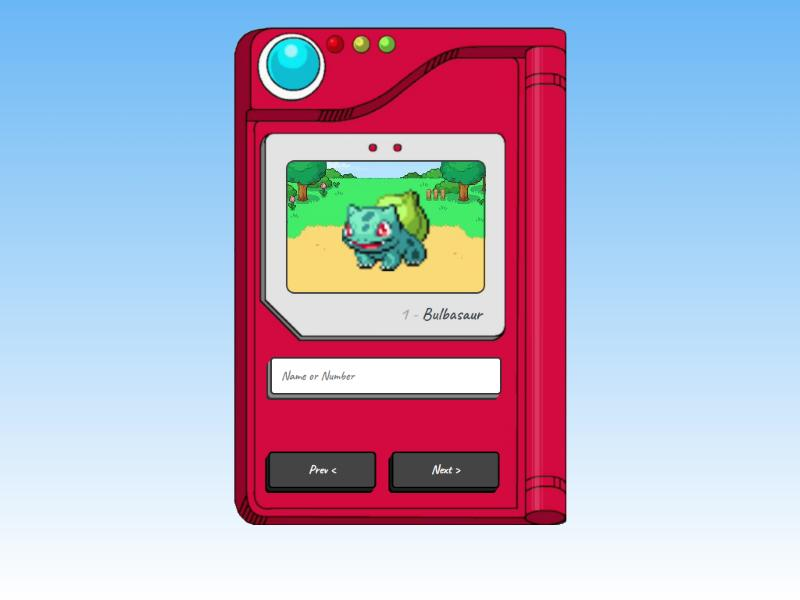

# Pokedex

Una Pokedex web construida con HTML, CSS y JavaScript vanilla que consume la
[PokeAPI](https://pokeapi.co/) para mostrar cualquier pokémon por nombre o número.



## Funcionalidades

- 🔍 Búsqueda por nombre o número de pokédex.
- ⬅️➡️ Navegación con botones **Prev** y **Next**.
- 🎞️ Sprites animados (generación V) con fallback a sprite estático para
  pokémon posteriores al #649.
- 🛡️ Manejo de errores: estado "Not found" para búsquedas sin resultado y
  fallos de red, con los botones deshabilitados mientras carga.

## Tecnologías

- HTML5
- CSS3 (posicionamiento absoluto sobre la imagen de la Pokedex, `clamp()` para
  tipografía fluida)
- JavaScript (ES2017+: `async/await`, `fetch`)
- [PokeAPI](https://pokeapi.co/) como fuente de datos

## Cómo ejecutarlo

No necesita dependencias ni build. Clona el repositorio y abre `index.html`
en el navegador, o sírvelo con cualquier servidor estático:

```bash
git clone https://github.com/Mystick94/pokedex.git
cd pokedex
python -m http.server 5500
```

Luego visita `http://localhost:5500`.

## Créditos

Proyecto basado en el tutorial de [Manual do Dev](https://github.com/manualdodev/pokedex),
con correcciones y mejoras propias (fallback de sprites, manejo de errores,
estados de carga y arreglos de CSS). La imagen del marco de la Pokedex
pertenece al tutorial original.
